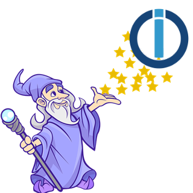

# ioBroker.tion_lite

BLE-драйвер Tion BR_LITE для ioBroker на Linux. Один бризер на экземпляр адаптера.
Реализован на TypeScript, использует USB Bluetooth-контроллер через прямой native HCI backend Noble.

## Возможности

- Получение имени, Bluetooth-адреса и версии прошивки (число и hex).
- Включение и выключение бризера.
- Включение и отключение нагревателя.
- Задание температуры нагрева и скорости вентилятора 1–6.
- Чтение температуры входящего воздуха, наличия нагревателя и маски ошибок.
- Опрос, последовательная очередь команд и автоматическое переподключение.

Протокол восстановлен по приложению Tion Remote. Тесты используют пакеты и имитацию
HCI/Noble; работа на физическом бризере пока не подтверждена. Только BR_LITE: общий UUID
с другими Tion не означает совместимость команд. OTA и сброс фильтра не реализованы.

## USB Bluetooth и Linux-контейнер

Адаптер использует выделенный USB Bluetooth-донгл как Linux-контроллер `hci0` или
`hci1`. Backend — `@stoprocent/noble`, native HCI, exclusive user channel.
Сервис bluetoothd и системный D-Bus для обмена не используются. Сокет `/run/dbus`
из предыдущей версии можно убрать из конфигурации контейнера.

Linux-драйвер `btusb` должен распознать донгл. Устройства HCI принадлежат общему ядру
хоста: одного `devices: /dev/bus/usb/...` в Docker недостаточно. Для выбранного
native backend контейнеру нужны `network_mode: host`, `NET_ADMIN` и `NET_RAW`.
Это режим с контроллером, доступным через HCI, а не libusb-доступ к USB endpoints.

### Подготовка хоста

Найдите именно USB-контроллер, который выделяете адаптеру:

```sh
lsusb
hciconfig -a
readlink -f /sys/class/bluetooth/hci1/device
```

Замените `hci1` в командах и настройках на фактический номер. Для exclusive user
channel контроллер должен быть **down** до старта ioBroker:

```sh
sudo hciconfig hci1 down
```

Не используйте этот донгл одновременно из BlueZ, другого BLE-адаптера или другого
экземпляра tion_lite. Если Bluetooth-хост обслуживает только этот донгл, можно
остановить `bluetooth.service`; при наличии других Bluetooth-устройств не выключайте
весь сервис, но обеспечьте, чтобы он не включал выделенный контроллер обратно.
Не выгружайте `btusb`: native HCI backend требует зарегистрированный `hciX`.

### Docker Compose

Изменения в существующем сервисе ioBroker (пример USB-пути из `lsusb`):

```yaml
services:
  iobroker:
    # Сохраните текущие image и том данных ioBroker.
    network_mode: host
    cap_add:
      - NET_ADMIN
      - NET_RAW
    devices:
      - /dev/bus/usb/001/004:/dev/bus/usb/001/004
```

Путь `/dev/bus/usb/001/004` — пример; подставьте свой. USB mapping отражает выбранный
проброшенный донгл, но native HCI backend обращается к нему через HCI-сокеты ядра.
При переподключении USB адрес `/dev/bus/usb/...` и номер `hciX` могут измениться:
проверьте Compose и настройку экземпляра заново. При host networking секция `ports`
не используется; порты ioBroker становятся портами хоста. Пересоздайте контейнер.

Права нужны **процессу Node.js**, который запускает ioBroker. `cap_add` само по себе
не гарантирует capabilities у непривилегированного пользователя внутри образа.
Если ioBroker работает не от root, задайте file capabilities реальному Node binary
внутри контейнера с помощью `libcap2-bin`:

```sh
# Выполнить внутри контейнера от root.
setcap cap_net_raw,cap_net_admin+eip "$(readlink -f "$(command -v node)")"
getcap "$(readlink -f "$(command -v node)")"
```

После замены Node.js/образа повторите настройку. `no-new-privileges` или rootless
Docker могут не дать получить эти capabilities: используйте среду, которая
разрешает HCI user channel. Запуск адаптера в отдельном процессе обязателен;
`compact` отключён в metadata.

Включите режим подключения на самом бризере согласно его инструкции и задайте MAC
в Admin. Native HCI backend не использует сохранённые bonding-ключи BlueZ и не
реализует отдельное управление pairing. Если устройство требует BLE pairing с
шифрованием, совместимость этого режима требует проверки на устройстве.

Описание [HCI user channel и Docker в Noble](https://github.com/stoprocent/noble#choosing-a-linux-bluetooth-access-mode).

## Сборка и установка

Node.js >=20. В папке проекта:

```sh
npm ci
npm run check
npm test
npm run build
npm pack
```

Native HCI backend включён в обязательные зависимости. Для установки нужны
Linux-совместимые native binaries; при отсутствии prebuild потребуются Python 3,
make, g++, libbluetooth-dev и libudev-dev. Не используйте `--ignore-scripts` при
установке на целевой машине.
Сборка включает dev dependencies; не используйте `--omit=dev` до сборки.

Полученный архив `iobroker.tion_lite-0.0.2.tgz` перенесите в контейнер. Из каталога
установки ioBroker (обычно `/opt/iobroker`) установите локальный архив:

```sh
npm install /tmp/iobroker.tion_lite-0.0.2.tgz --omit=dev
iobroker add tion_lite
```

Затем задайте параметры экземпляра в Admin и перезапустите его. Не запускайте
`build/main.js` как самостоятельный сервис вне установленной среды ioBroker.

## Настройки экземпляра

| Параметр | По умолчанию | Назначение |
|---|---|---|
| address | пусто | MAC BR_LITE; обязателен |
| hci | hci0 | Выделенный USB HCI-контроллер, например hci1 |
| pollInterval | 5 | Интервал опроса, секунды, 5–3600 |
| responseTimeout | 3000 | Таймаут ответа бризера, миллисекунды, 1000–10000 |
| maxTemperature | 25 | Максимальная задаваемая температура: 25 либо 30 °C |

Диапазон температуры в приложении зависит от локали. 25 °C — консервативный предел;
30 °C включайте после проверки поддержки вашим устройством. Нулевое значение
температуры допустимо; состояние нагревателя задаётся отдельным переключателем.

## States

Все ID ниже относительны `tion_lite.0` (номер экземпляра может отличаться).

| State | Тип / доступ | Значение |
|---|---|---|
| info.connection | boolean / R | Устройство подключено, информация и состояние прочитаны |
| info.address / info.name / info.model | string / R | Адрес, имя и настроенная модель BR_LITE |
| info.firmwareVersion | number / R | Сырые 16 бит версии прошивки |
| info.firmwareHex | string / R | Та же версия в hex, например 1234 |
| info.lastSeen | number / R | Время последнего валидного состояния, Unix ms |
| control.power | boolean / RW | Включение бризера |
| control.heaterEnabled | boolean / RW | Разрешение нагрева |
| control.targetTemperature | number / RW | Целевая температура, целое 0–25/30 °C |
| control.fanSpeed | number / RW | Скорость, целое 1–6 |
| sensors.inputTemperature | number / R | Температура входящего воздуха, °C |
| sensors.heaterPresent | boolean / R | Наличие нагревателя |
| diagnostics.errorMask | number / R | Неизменённая маска ошибок и предупреждений |
| diagnostics.lastError | string / R | Последняя ошибка обмена или команды |
| diagnostics.commandStatus | string / R | idle, pending, confirmed, failed |
| commands.refresh | boolean / W | Запись true вызывает чтение, затем кнопка сбрасывается |

Команды записываются с `ack:false`, подтверждённые показания публикуются с `ack:true`.
Выключение выполняется через `control.power=false`; fanSpeed=0 не является командой
выключения. Нагреватель и питание независимы: включение нагревателя само по себе
не включает бризер. `heaterEnabled` не показывает фактическую текущую мощность нагрева.

Перед каждой записью драйвер читает свежую конфигурацию, сохраняет пресеты,
звуковую и световую индикацию. После SET ждёт 1.5 с и читает состояние повторно;
`confirmed` выставляется только при совпадении изменённых полей. Завершение GATT
записи не считается подтверждением. При ошибке отправленная команда не повторяется
автоматически; драйвер переподключается и заново получает состояние.

Из-за неоднозначного расположения ID в декомпилированном приложении используется
одна ожидающая команда и проверка opcode/readback. Строгая корреляция всех ID требует
захвата реального обмена; задержанный ответ может влиять на эту проверку. CRC и длина
входящих сообщений проверяются, повреждённые сообщения отбрасываются.

## Диагностика

- `info.connection=false`: проверьте address/hci, режим подключения бризера,
  доступ к HCI в контейнере и `diagnostics.lastError`.
- `unsupported`/`unauthorized`: проверьте `network_mode: host`, capabilities Node.js,
  наличие выбранного `hciX` и состояние **down** до запуска адаптера.
- Ошибка native addon: установите зависимости на целевой Linux/архитектуре;
  не переносите node_modules с macOS или другой архитектуры.
- `HCI operation timed out`: проверьте USB-донгл, radio/rfkill, MAC и отсутствие
  другого процесса, который занял контроллер. Нужен выделенный донгл.
- `Response timeout`: устройство занято другим клиентом, ошибочная модель, слабый
  сигнал либо неподтверждённая особенность протокола.
- `Discarded BLE packet` при debug: неверные фрагменты, длина или CRC; нужен захват
  обмена для сравнения с протоколом.
- `did not confirm`: фактическое значение отличается от заданного; команда
  не выдаётся за успешную.

## Разработка

- `src/lib/protocol.ts`: команды, CRC, фрагментация и парсеры.
- `src/lib/hci.ts`: прямой HCI backend Noble, scan/connect/notifications.
- `src/lib/transport.ts`: общий контракт BLE транспорта.
- `src/lib/session.ts`: очередь, таймауты и readback.
- `src/main.ts`: конфигурация, states и reconnect.
- `npm run test:ts`: тесты codec, сессии и имитации HCI/Noble.
- `npm run test:package`: проверки структуры пакета ioBroker.
- `npm run lint`, `npm run check`, `npm run build`: статические проверки и сборка.

API транспорта: [Noble](https://github.com/stoprocent/noble),
[native HCI socket](https://github.com/stoprocent/node-bluetooth-hci-socket).

## Changelog

### 0.0.2

* (DimiDr0l) Replace host D-Bus transport with direct native HCI access to a dedicated USB Bluetooth controller.

### 0.0.1

* (DimiDr0l) Implement BR_LITE device information, power, heater, temperature and fan controls through host BlueZ.

## License
MIT License

Copyright (c) 2026 DimiDr0l <dimidr@gmail.com>

Permission is hereby granted, free of charge, to any person obtaining a copy
of this software and associated documentation files (the "Software"), to deal
in the Software without restriction, including without limitation the rights
to use, copy, modify, merge, publish, distribute, sublicense, and/or sell
copies of the Software, and to permit persons to whom the Software is
furnished to do so, subject to the following conditions:

The above copyright notice and this permission notice shall be included in all
copies or substantial portions of the Software.

THE SOFTWARE IS PROVIDED "AS IS", WITHOUT WARRANTY OF ANY KIND, EXPRESS OR
IMPLIED, INCLUDING BUT NOT LIMITED TO THE WARRANTIES OF MERCHANTABILITY,
FITNESS FOR A PARTICULAR PURPOSE AND NONINFRINGEMENT. IN NO EVENT SHALL THE
AUTHORS OR COPYRIGHT HOLDERS BE LIABLE FOR ANY CLAIM, DAMAGES OR OTHER
LIABILITY, WHETHER IN AN ACTION OF CONTRACT, TORT OR OTHERWISE, ARISING FROM,
OUT OF OR IN CONNECTION WITH THE SOFTWARE OR THE USE OR OTHER DEALINGS IN THE
SOFTWARE.